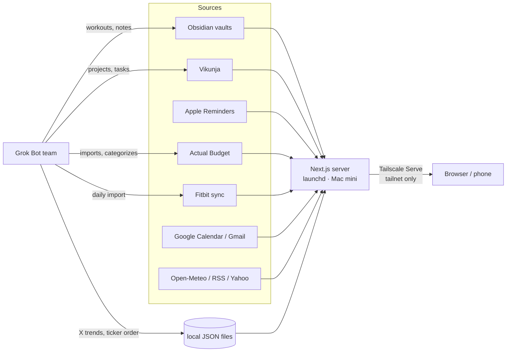

# Home

A self-hosted personal dashboard built to run on an always-on Mac and to be reachable only over your Tailscale tailnet. One fast, keyboard-friendly app pulls together the day, tasks, home-server health, budget, health and workouts, and full-text search across Obsidian vaults.

> All screenshots below use **demo mode** (`npm run demo`): every name, number, note and transaction is synthetic.


## Tabs

| Tab | What it shows | Source |
|---|---|---|
| **Today** | A timeline of the day with a "now" rule and tonight's workout slotted in, headlines and X trending, due-today to-dos and reminders (tick to complete, with undo), replies worth sending, body metrics, and Markets: a SPY / 10-year / WTI row plus an ordered watch list of day moves (top N, "Show more" for the rest; every row opens your TradingView chart layout) | Google Calendar + Gmail (read-only), Open-Meteo, RSS / curated brief, a local X-trends file, Apple Reminders (`remindctl`), Yahoo chart quotes (cached 60 s), Fitbit exports |
| **Projects** | An overview of projects, then a kanban board per project with a task detail panel; cards can be dragged between buckets | Vikunja API (reads, plus card moves only) |
| **Systems** | Up/degraded/down for every home service, with a 24-hour history | Services table in a vault note, local probes, optional health feed JSON |
| **Budget** | Pace vs. target, category trends, upcoming bills, card interest, and a short "what to do" list | Actual Budget via `@actual-app/api`, cached by a read-only sync job |
| **Health** | Overview (sleep stages, overnight signals, activity, two-week trends) and Workouts (week strip, today's sets checklist, training log, records, a "Tell Gym" box for a coaching agent) | Fitbit raw exports + training notes in the vault |
| **Query** | SQLite FTS5 search across vaults, with rendered markdown (wikilinks, callouts, embeds) | Obsidian vaults on disk |

| | |
|---|---|
|  |  |
|  |  |
|  |  |
|  |  |
|  | |

### Settings

The gear at the bottom of the rail (or **More → Settings** on a phone, or `⇧S`) opens `/t/settings`:

- **Pages:** show, hide and reorder tabs (drag or arrow buttons). The order drives the rail, the phone bar (first four visible), `⌘1–9` and `⌥↑`/`⌥↓`. Today can't be hidden and at least one tab always stays visible.
- **Appearance:** theme (System / Dark / Light, applied server-side so every device matches) and web fonts.
- **Per-tab knobs**, declared by each plugin's optional `settings` schema: Today's headline sentence, headline and trend counts, market tickers (orderable chips: drag or `Alt+←/→`), how many show before "Show more", ticker order (saved, or an order-only `holdings-rank.json` a local agent keeps fresh) and the TradingView chart layout URL; weather location and headline topics are edited in place on Today; Budget's over-pace threshold, bill categories and reminder window; Health's temperature unit, nav badge and training-log status; which vaults Query searches; how notes render task checkboxes and Dataview blocks.

Changes autosave to `~/.config/home-dashboard/settings.json` (mode 600, outside the repo, override with `HD_SETTINGS_FILE`). The file is validated with zod and layered over `lib/home-config.mjs`; an invalid file falls back to the defaults. Each section has its own Reset.

### Keyboard

`⌘K` palette · `⌥↑`/`⌥↓` previous/next tab · `⌘1–9` tab by position · `t p s b h q` jump straight to Today, Projects, Systems, Budget, Health, Query (or `g` then the letter) · `⇧S` Settings · `/` search · `j`/`k` rows · `[`/`]` sub-views · `r` refresh · `?` all shortcuts · `Esc` close. Every text field has a mic button for dictation (the browser's built-in Web Speech API).

## Architecture

- **Next.js 16 / React 19 / TypeScript**, server-rendered. `scripts/start.mjs` binds to `127.0.0.1` only and rejects unknown `Host`/`Origin` headers and cross-site writes.
- **Tailscale Serve** gives tailnet-only HTTPS on its own port. Funnel is never used, and there is no public login; the tailnet is the boundary.
- **launchd** keeps the server running (`npm run service:install`) plus two helper jobs: Budget sync (every 30 min) and overnight-mail curation.
- **Private data stays outside Git**: runtime SQLite, caches and logs live in the OS app-data directory and `~/.local/share/home-dashboard/`. Secrets go in a mode-600 env file (below).
- **Writes are deliberately narrow.** Vault content is read-only except two writes: (1) flipping `- [ ]`↔`- [x]` on an existing set line in `fitness/workouts/YYYY-MM-DD.md`, matched by line hash with a per-file lock and an atomic rename, and (2) appending to `fitness/gym-inbox.md`. Vikunja and Actual are read-only.

```
app/
  t/[tab]/page.tsx        one route renders any tab
  tabs/registry.ts        list of tab plugins
  tabs/<id>/plugin.tsx    data loader + metadata
  tabs/<id>/view.tsx      UI
  api/…                   dashboard, query, settings, budget sync, workout check, gym
  t/settings/             Settings view (pages, appearance, per-tab knobs)
components/home/          shell (rail, tab bar, palette, shortcuts), markdown, mic
lib/                      source adapters (calendar, gmail, health, workouts, budget, systems, query, demo fixtures)
lib/home-config.mjs       every design/behaviour switch in one place
lib/settings.mjs          user settings: schema, validation, persistence
public/                   favicon (SVG + ICO), apple-touch icon, PWA icons (manifest in app/manifest.ts)
scripts/                  start, service installers, budget sync, demo
tests/                    node:test suites (synthetic data only)
```

### Tab plugin contract

Every tab is a `TabPlugin<D>` (`app/tabs/types.ts`):

```ts
interface TabPlugin<D> {
  id: TabId; title: string; icon: LucideIcon; order: number;
  status: 'live' | 'hidden';
  settings?: SettingsSection | (() => SettingsSection);   // optional knobs shown in Settings
  refreshSeconds: number;                      // 0 = no auto refresh
  load(ctx: { now: Date; signal: AbortSignal; params: URLSearchParams }): Promise<SourceResult<D>>;
  View: FC<{ data: D; fetchedAt: Date }>;
  attention?(data: D): { count: number; tone: 'warn' | 'over' } | null;   // rail badge
  summary?(data: D): string;                                            // palette / jump sheet line
  Skeleton?: FC;
}
```

`load` runs on the server once per request (shared by the nav badges and the page), is timed and logged, and returns `ok(data)` or `fail(error, stale?)`. To add a tab, create `app/tabs/<id>/plugin.tsx` and `view.tsx`, then add it to `registry.ts`.

## Quick start (demo mode first)

Requires Node 22.13+ (macOS or Linux for the demo).

```sh
git clone https://github.com/wilburbuilds/home-dashboard.git
cd home-dashboard
npm ci
npm run build
npm run demo          # http://127.0.0.1:3200, synthetic data for every tab
```

Demo mode writes invented fixtures to a temporary directory (`HD_DEMO_DIR`, default `$TMPDIR/home-dashboard-demo`) and points every adapter there. Nothing personal is read and nothing leaves the machine. Checks: `npm run typecheck` and `npm run test:unit`.

## Running it for real

The real setup targets a Mac that is always on (a Mac mini works well) and is on your Tailscale tailnet.

1. **Config.** Open `lib/home-config.mjs`. Every design and behaviour switch lives there: theme, vault paths, budget thresholds, phone tab order, and so on. The defaults read vaults from `~/vaults/personal` and `~/vaults/work`.
2. **Secrets.** Create `~/.config/home-dashboard/env` with mode 600 (see the variables below). It is never sent to the browser.
3. **Build and run:** `npm ci && npm run build && npm start` serves http://127.0.0.1:3000 (loopback only).
4. **Keep it running:** `DASHBOARD_ORIGIN=https://<machine>.<tailnet>.ts.net:9443 npm run service:install` installs a LaunchAgent that starts at login and restarts on crash.
5. **Expose it to your tailnet only:** `tailscale serve --bg --https=9443 http://127.0.0.1:3000`. Never use Funnel.
6. **Optional sources:**
   - **Budget:** run Actual Budget locally, then set `ACTUAL_SYNC_ID` and the keychain item (or `ACTUAL_SERVER_PASSWORD`), then `npm run service:install-budget-sync`.
   - **Projects:** a Vikunja URL and an API token.
   - **Google Calendar and Gmail** (read-only): put an OAuth client in `~/.config/home-dashboard/google/oauth.json` (see `google-oauth.example.json`), then run `npm run oauth:google`.
   - **Health:** Fitbit JSON exports under `<vault>/fitness/fitbit-air/raw/YYYY-MM-DD.json`, `fitness/current-program.md`, `fitness/training-log.md`, and daily set notes at `fitness/workouts/YYYY-MM-DD.md` (one `- [ ] Exercise — set N — target` line per set).
   - **Systems:** a markdown table in `<vault>/home/services.md` with the columns `Service | What it is | Reach it at | Lifecycle`, plus probes in `lib/sources/systems.mjs`.

### Environment variables (names only)

Secrets file `~/.config/home-dashboard/env`: `VIKUNJA_URL`, `VIKUNJA_API_TOKEN`, `GYM_WEBHOOK_URL`, `GYM_WEBHOOK_SECRET` (optional webhook for the "Tell Gym" box).

Process env:
- **Server and paths:** `DASHBOARD_ORIGIN`, `PORT`, `DASHBOARD_DATA_DIR`, `DASHBOARD_PERSONAL_VAULT`, `DASHBOARD_MORNING_HTML`
- **Google:** `DASHBOARD_GOOGLE_CONFIG_DIR`, `DASHBOARD_GOOGLE_OAUTH`, `DASHBOARD_GOOGLE_TOKENS`, `GOOGLE_ACCOUNT_HINT`
- **Actual:** `ACTUAL_PUBLIC_URL`, `ACTUAL_SYNC_ID`, `ACTUAL_SERVER_PASSWORD`, `ACTUAL_KEYCHAIN_SERVICE`, `ACTUAL_KEYCHAIN_ACCOUNT`
- **Vikunja:** `VIKUNJA_PUBLIC_URL`, `VIKUNJA_DEFAULT_PROJECT`
- **Other integrations:** `GROK_BIN`, `HOMEKIT_BIND_ADDRESS`, `HOMEKIT_RECEIVER_URL`
- **App internals and demo:** `HD_DATA_DIR`, `HD_ENV_FILE`, `HD_LOAD_LOG`, `HD_SERVICES_FILE`, `HD_HEALTH_FEED`, `HD_QUERY_VAULTS`, `HD_SETTINGS_FILE`, `HD_DEMO`, `HD_DEMO_DIR`

## What powers this

| System | Role |
|---|---|
| [Grok Bot](https://x.ai/bot) | A small team of AI bots that keep the data fresh and the app moving: a fitness bot writes the day's workout and runs the daily Fitbit import, a news bot writes the X trends file, a finance bot imports and categorizes transactions in Actual Budget and keeps the ticker order current, bots plan projects and keep tasks current in Vikunja, and an engineering bot builds and ships the app itself. Bots write to the vault, local files, Vikunja and Actual; the dashboard only reads them and never calls the bots. |
| [Obsidian](https://obsidian.md) | Git-backed markdown vaults: notes, training plans and logs, the services table, and everything Query searches. |
| [Vikunja](https://vikunja.io) | Self-hosted projects and kanban boards, kept current by the bots. The dashboard reads them and can move cards between buckets. |
| [Apple Reminders](https://support.apple.com/guide/reminders/welcome/mac) | Due-today to-dos, read and ticked off through a local CLI. |
| [Tailscale Serve](https://tailscale.com/kb/1312/serve) | HTTPS on the tailnet only; nothing is exposed to the internet. |
| [Actual Budget](https://actualbudget.org) | Self-hosted budgeting. A finance bot imports and categorizes transactions; the dashboard reads it through a scheduled sync job. |
| [Fitbit Web API](https://dev.fitbit.com/build/reference/web-api/) | A self-hosted sync, run daily by the fitness bot, exports sleep, heart rate and steps as JSON into the vault. |
| [Yahoo Finance](https://finance.yahoo.com) | Day moves for the Markets row and watch list (chart quotes, cached 60 s server-side). |
| [RSS](https://www.rssboard.org/rss-specification) | Headlines from a short list of feeds, filtered by your topics. |
| [Open-Meteo](https://open-meteo.com) | Weather and forecast, no API key. |
| [Google Calendar](https://developers.google.com/calendar) and [Gmail](https://developers.google.com/gmail/api) APIs | The day's timeline and replies worth sending (read-only OAuth). |
| [Next.js](https://nextjs.org) | The app: React server components, route handlers, one Node process. |
| [shadcn/ui](https://ui.shadcn.com) | UI primitives (dialogs, sheets, popovers, command palette). |
| [Recharts](https://recharts.org) | Budget and health charts. |
| [launchd](https://support.apple.com/guide/terminal/script-management-with-launchd-apdc6c1077b-5d5d-4d35-9c19-60f2397b2369/mac) on a [Mac mini](https://www.apple.com/mac-mini/) | Keeps the server and the sync jobs running, restarts on crash. |



## Hosting and privacy

- **Built for a tailnet, not the internet.** The server listens on 127.0.0.1, checks `Host` and `Origin`, and refuses cross-site writes. Tailscale Serve terminates HTTPS. There is no login system, so do not port-forward it or enable Funnel.
- **Personal data stays out of Git.** Health exports, messages, budget data, vault content, tokens and databases belong outside the repository. `.gitignore` covers env files, SQLite/DB files, logs and caches.
- **Writes are narrow.** The only vault writes are the two edits described under Architecture; Settings writes only its own `settings.json`. Outside the vault there are exactly two: moving a Vikunja card between buckets (`POST /api/projects/move`) and completing or un-completing an open Apple Reminder by id (`POST /api/todos/reminder`, same-origin, strictly validated, logged). Markets stores tickers and their order only, never quantities or values.

## License

MIT. See [LICENSE](LICENSE).
